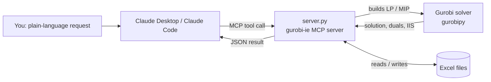

# gurobi-ie-mcp

**An MCP server that connects Claude to the Gurobi optimisation solver for industrial-engineering problems.**

Ask Claude in plain language ("make an 8-week production plan from this Excel file", "what if week 6 loses 200 hours?", "which warehouses should we open?") and it builds the optimisation model, solves it with Gurobi, and explains the result: the plan, the cost, which constraints are binding, and what an extra hour of capacity is worth.

Course project for **Gen AI for Engineers**, Yaşar University, October 2026.
Team: Mert Karaca, _(add teammates)_

---

## How it works



Claude chooses a tool and fills in its parameters, `server.py` turns them into a Gurobi model, and Gurobi solves it. The result comes back to Claude, which interprets it or asks for the next run. Every tool call is visible in the chat and needs your approval.

## Tools

| Tool | Problem | What you get back |
|---|---|---|
| `production_plan` | Multi-product, multi-period aggregate planning: production, inventory, overtime, optional backorders and setup costs (LP or MIP) | Plan per period, cost breakdown, capacity utilisation, **shadow price of capacity**; if infeasible, the conflicting constraints (IIS). Optional Excel output with a capacity chart. |
| `facility_location` | Capacitated facility location (MIP) | Facilities to open, shipments, fixed vs transport cost, utilisation |
| `schedule_jobs` | Parallel identical machines, minimise makespan or weighted tardiness (MIP) | Start/end per job and machine, tardiness, text Gantt chart |
| `solve_custom_model` | Any LP/MIP written out explicitly: product mix, blending, assignment, staffing… | Variable values, objective, shadow prices, slacks, reduced costs (LP) |
| `read_excel_table` | Load input data from an .xlsx file | Headers and rows |

The docstrings in `server.py` are the "manual" Claude reads to decide which tool to use, so every parameter name includes its unit (`_hours`, `_units`, `_per_unit`).

## Setup

**Requirements:** Python 3.10+ and Claude Desktop (or Claude Code). No Gurobi licence setup is needed: `pip install gurobipy` ships a free size-limited licence (2000 variables / 2000 constraints), which is enough for course-sized models.

### Windows

1. Download this repository (**Code → Download ZIP**) and extract it.
2. Double-click `install.bat`. It installs `gurobipy`, `mcp` and `openpyxl`, solves a test model, and prints the full path to `server.py`.
3. In Claude Desktop open **Settings → Developer → Edit Config** and add this block inside the top-level `{ }` of `claude_desktop_config.json` (keep everything that is already there, and write every `\` as `\\`):

```json
"mcpServers": {
  "gurobi-ie": {
    "command": "py",
    "args": ["C:\\path\\to\\gurobi-ie-mcp\\server.py"]
  }
},
```

4. Fully quit Claude Desktop (also from the system tray) and reopen it. **gurobi-ie** should appear in the tools menu with 5 tools.

### macOS / Linux

```bash
pip install -r requirements.txt
# Claude Code:
claude mcp add gurobi-ie -- python3 /path/to/gurobi-ie-mcp/server.py
```

For Claude Desktop on macOS the config file is `~/Library/Application Support/Claude/claude_desktop_config.json`; use `"command": "python3"`.

## Try it

`demo_demand.xlsx` holds 8 weeks of demand for a heating-products plant (boilers, heat pumps, water heaters) plus capacities and costs.

> Use gurobi-ie. Read demo_demand.xlsx (both sheets) and build an 8-week production plan with whole units. Write it to plan_output.xlsx. Which weeks are at full capacity?

Result (also in [`examples/plan_output.xlsx`](examples/plan_output.xlsx)):

| Week | Boiler | Heat pump | Water heater | Utilisation |
|---|---|---|---|---|
| W1 | 90 | 30 | 150 | 48 % |
| W2 | 130 | 45 | 210 | 70 % |
| W3 | 150 | 60 | 180 | 77 % |
| W4 | 170 | 70 | 190 | 86 % |
| W5 | 160 | 80 | 290 | 99 % |
| W6 | 140 | 90 | 305 | 100 % |
| W7 | 180 | 100 | 190 | 100 % |
| W8 | 200 | 110 | 115 | 100 % |

Total cost 29,797,000 TL with no overtime: Gurobi builds water heaters early in weeks 5–6 so that weeks 7–8 fit in regular hours.

Follow-up "what-if" questions used in the live demo are in [`DEMO_SCRIPT.md`](DEMO_SCRIPT.md): a maintenance week, the value of extra capacity (shadow prices), an infeasible plan explained by its IIS, scheduling and facility location.

### Checked by hand

- Week 1 hours: 90 × 2 + 30 × 3.5 + 150 × 1 = 435 h ≤ 900 h. ✔
- Facility location demo: opening Manisa and Aydın gives capacity 450 ≥ demand 370; fixed cost 6,500 + transport 920 = **7,420**, the same as the solver's answer. ✔
- Week 1 under a supplier delay: it needs 435 h but only 300 + 120 = 420 h exist, which is why the solver reports infeasibility in weeks 1–2. ✔

## Design choices

- **Why our own server and not Gurobi's official one?** Gurobi offers an official MCP server ([Gurobi Intelligence](https://docs.gurobi.com/projects/intelligence/en/current/mcp-server.html)) that runs in Docker, needs an Intelligence Hub account, and generates `gurobipy` code with AI agents. For a course demo we wanted no account or Docker, the free licence, and a small set of fixed, tested tools whose behaviour is predictable during live modifications.
- **Structured tools plus one general tool:** the three IE tools cover common problems with validated models. `solve_custom_model` lets Claude formulate anything else on the spot.
- **Explain, not just solve:** shadow prices, slacks and the IIS of infeasible models are returned so Claude can say *why* the answer is what it is.

## Safety and limits (handout section 7 checklist)

| Check | Answer |
|---|---|
| Official or community? | Our own server, using Gurobi's official `gurobipy` library |
| Licence | MIT (this repo); Gurobi's free pip licence is size-limited and for evaluation and academic use |
| Software / OS | Python 3.10+, any OS; tested on Windows with Claude Desktop |
| Mock or real? | Real: every result comes from the Gurobi solver. There is no mock fallback; errors are returned as errors. |
| Risky tools? | No code execution, no deletion. It only reads the Excel files you name and writes the output file you name. |
| Size limit | Free licence: 2000 variables / 2000 constraints. `schedule_jobs` proves optimality in about a second for up to ~8 jobs; larger cases return the best schedule found within the time limit (default 20 s) and say it is not proven optimal. |

An optimal answer is only as good as the model and data. Units, costs, capacities and assumptions remain the engineer's responsibility.

## Tests

```bash
cd tests && python test_client.py
```

This starts the server as a real MCP client would and calls every tool.

## Use of AI

The server code, tests, documentation and demo data were written with Claude (Anthropic). We reviewed the models, ran the tests, and checked the key numerical results by hand (see "Checked by hand").

## Licence

MIT. See [LICENSE](LICENSE).
